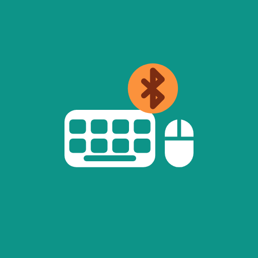
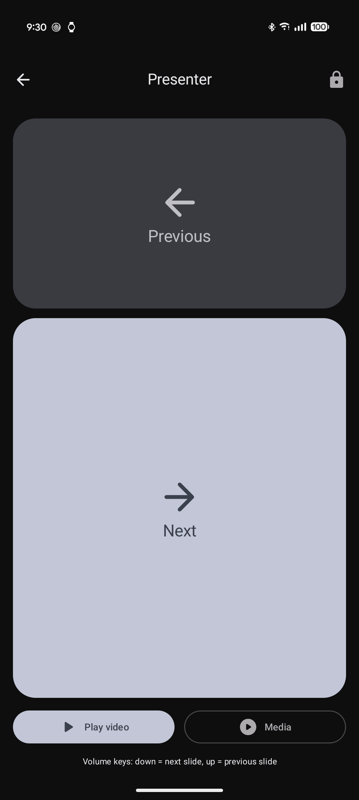
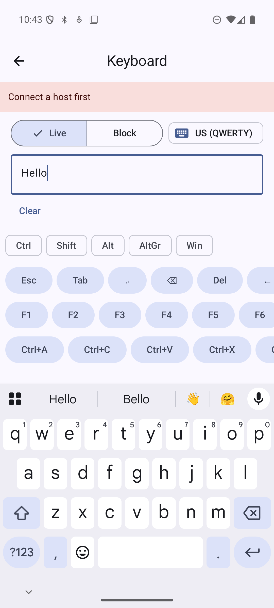
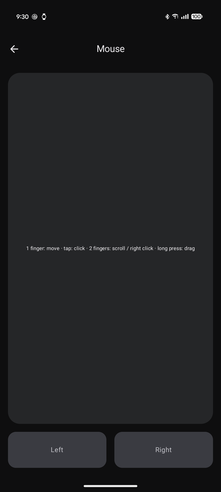

# Bluetooth HID

Turn an Android phone into a **Bluetooth keyboard, mouse and presentation remote** for any computer — no app, driver or dongle on the computer side.

Built because existing "scan a QR code and type it" apps were slow and sometimes typed the wrong characters. This app types long payloads (passwords, Wi-Fi keys, URLs, config strings) **exactly**, and fast.

| Presenter | Locked presenter | Keyboard | Mouse |
|---|---|---|---|
|  |  |  |  |

## Features

- **Scan & type** — scan a QR code or barcode, preview the text (characters the host layout cannot type are shown in red), then type it on the computer. Progress bar, cancel, and *Resume* if the link drops mid-way.
- **Keyboard** — type with your normal Android keyboard (Gboard, swipe, voice); text goes live to the computer. Special keys bar: Esc, Tab, arrows, Home/End, F1–F12, sticky Ctrl/Shift/Alt/AltGr/Win(⌘), shortcuts, media keys. *Block* mode composes text first and sends it in one go.
- **Mouse** — touchpad with acceleration, tap to click, two-finger scroll and right-click, long-press drag lock, hold-to-drag buttons.
- **Presenter** — big Next/Previous zones (PageDown/PageUp, like commercial clickers), **phone volume keys change slides**, PowerPoint video play/pause, media play/pause, vibration on each slide change, screen kept on, and a YouTube-style **screen lock** so only the volume keys act.
- **Exact typing across layouts** — the computer's keyboard layout decides which character a key prints, so the app maps text per host layout: **US QWERTY, French AZERTY (Windows), French AZERTY (Linux), French AZERTY (Mac)**, including dead-key accents (`ê`, `ï`…). The layout is remembered per computer.
- **Reliable link** — a foreground service holds the connection across screens; reports go through one paced queue (Fast 6 ms / Normal 10 ms / Safe 25 ms) with retries, and every cancel or failure releases all keys so nothing stays stuck.
- English and French UI. No network access, no analytics.

## Requirements

- Android 16 (API 36) or newer, with Bluetooth HID device profile support (Pixel phones and most recent devices).
- A computer with Bluetooth: Windows, macOS or Linux.

## Getting started

1. Install the app and grant the Bluetooth (and notification) permission.
2. **Hosts › Pair new host** — the phone becomes visible for 2 minutes. On the computer, add a Bluetooth device and select the phone.
3. On the Home screen, tap the layout chip and pick the **keyboard layout configured on the computer**.
4. Use Scan & type, Keyboard, Mouse or Presenter.

> **Typing does nothing after switching from another keyboard app?** Computers store the phone's keyboard description when pairing. If the phone was paired while another HID app was active, remove the phone from the computer's Bluetooth devices (and forget the computer on the phone), then pair again.

## Building

```bash
./gradlew :app:assembleDebug          # APK in app/build/outputs/apk/debug/
./gradlew :app:testDebugUnitTest      # unit tests (JVM)
./gradlew :app:lintDebug              # lint, must stay at 0 errors
```

Requires a JDK to start Gradle; the build toolchain (JDK 25) is provisioned automatically. Open the project in a recent Android Studio for development.

The Bluetooth HID profile is not available on the emulator for real hosts — test typing on a physical phone (wireless debugging works well).

## Project layout

```
app/src/main/java/com/fnosari/bluetoothhid/
├─ activities/<feature>/        one Activity per feature (main, scan, keyboard, mouse, presenter, settings)
│   ├─ screens/                 Compose screens
│   └─ components/              feature-specific composables
├─ connectivity/hid/            app-agnostic HID framework
│   ├─ HIDDescriptor.kt         report descriptor (keyboard ID 1, mouse ID 2, consumer ID 3)
│   ├─ HIDReport.kt / HIDKeys.kt
│   ├─ HIDReportQueue.kt        paced single-thread sender
│   ├─ HIDDevice.kt             BluetoothHidDevice wrapper
│   └─ layouts/                 keyboard layouts + TextTyper (text → reports)
├─ services/HIDForegroundService.kt   owns the connection
├─ persistance/preferences/     DataStore preferences
└─ ui/, utils/, model/
```

Design notes live in [`docs/superpowers/`](docs/superpowers/).

## Contributing

Contributions are welcome — especially new keyboard layouts and host-compatibility reports. Read [CONTRIBUTING.md](CONTRIBUTING.md) and the [Code of Conduct](CODE_OF_CONDUCT.md).

## Privacy

The app has no internet permission and collects nothing. See [PRIVACY.md](PRIVACY.md).

## License

[Apache License 2.0](LICENSE) — © 2026 Florent NOSARI.
